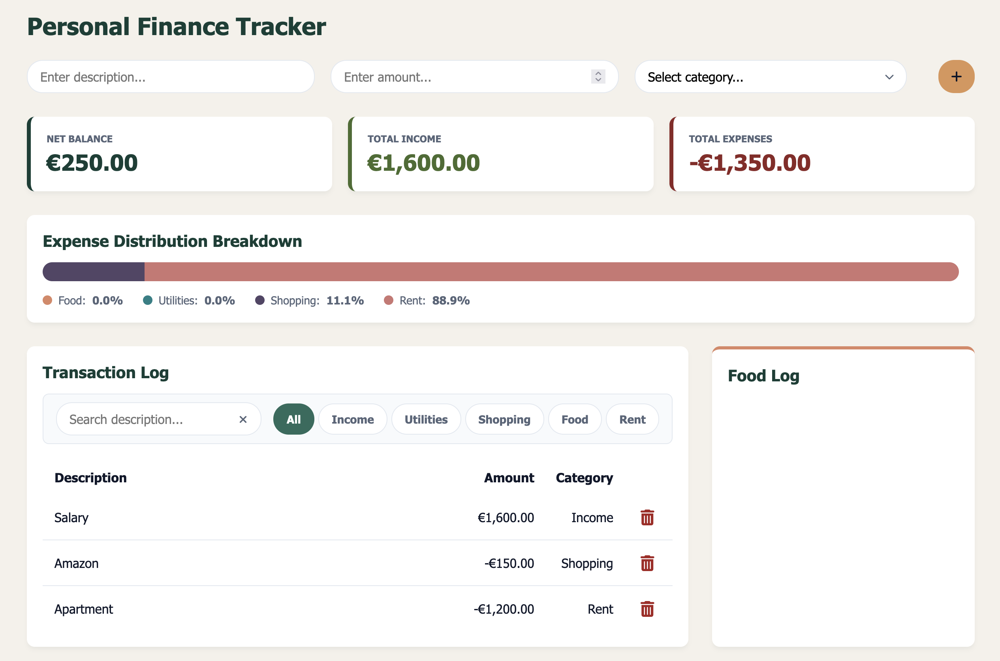

# 💰 Personal Finance Dashboard

A clean, responsive financial dashboard built with vanilla JavaScript, modern CSS, and state-driven DOM management.



## ✨ Features
- **Real-Time Analytics**: Automatically updates total balance, income, expenses, and category percentage distributions.
- **Visual Progress Overview**: Expense breakdown chart with color-coded category tracking.
- **Dynamic Ledger Filtering**: Filter transactions instantly via keyword search or category tabs.
- **Data Persistence**: Saves transaction history locally using `localStorage`.
- **State-Driven UI**: Clean UI state handling driven by custom `data-*` CSS attributes.
- **Accessible & Responsive**: Keyboard-navigable controls and responsive Flexbox/Grid layouts.

## 🛠️ Tech Stack
- **Frontend**: HTML5, Modern CSS (Custom Properties, Nesting, Flexbox, Grid)
- **Logic**: JavaScript (ES6+)
- **Icons**: FontAwesome

## 🚀 Getting Started

### Prerequisites
Any modern web browser (Chrome, Firefox, Safari, Edge). No external dependencies or build tools required.

### Installation
1. Clone the repository:
   ```bash
   git clone [https://github.com/silviacremascoli/personal-finance-tracker.git](https://github.com/silviacremascoli/personal-finance-tracker.git)